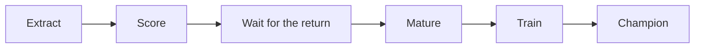

# signal4orge

A quarterly ridge ranker that scores stocks from five filing-date features, flags the weakest fifth, and refits only after those returns are realized.

Each company in a filing quarter is scored from information known on the filing date. The lowest fifth of scores is flagged as weak. The score stays pending until the next quarter's return is known. Completed quarters are then used to check the flag and to fit the next model.

The service stores filings, prices, scores, and realized outcomes in Postgres. FastAPI serves the current flag and the record of how those flags turned out.

## How a quarter moves

Four jobs run in order. Each job is its own runner and calls only its own stages.

1. **Extract.** [ExtractPipeline](src/signal4orge/pipeline/extract_pipeline.py) runs [DataIngestion](src/signal4orge/stages/data_ingestion.py), which appends filings and daily bars to `landing` and leaves an existing row as stored. It then runs [DataTransformation](src/signal4orge/stages/data_transformation.py), which writes one `feature_panel` row per company and quarter. The five features use only what was known at TimePoint A, the filing date.

2. **Score.** [PredictPipeline](src/signal4orge/pipeline/predict_pipeline.py) loads the weights in `models/champion/` and writes one `prediction_log` row per company: the score, the weak flag, the five feature values, the model version, and the as-of time. `outcome.forward_return` and `actual_weak` stay empty.

3. **Mature.** After that quarter's return is known, [MaturePipeline](src/signal4orge/pipeline/mature_pipeline.py) runs [Maturity](src/signal4orge/stages/maturity.py) and fills those two outcome fields. Until then the score is pending.

4. **Train.** [TrainPipeline](src/signal4orge/pipeline/train_pipeline.py) runs [ModelTrainer](src/signal4orge/stages/model_trainer.py) on earlier completed quarters and holds out the newest completed quarter. It saves a challenger, then [ModelRegistry.promote_if_clears](src/signal4orge/registry.py) is the only step that may copy that artifact into `models/champion/`.

## What talks to what

Jobs write through the repositories in [db/](src/signal4orge/db). The API in [app/](app) only reads Postgres. A request never starts a job.

- `GET /health`
- `GET /scores?quarter=` reads `prediction_log` for one quarter
- `GET /scores/{ticker}` reads the served score for one company
- `GET /monitor` uses [Monitor.summarize](src/signal4orge/stages/monitor.py) for the pending count and the confusion totals on matured rows

Local Postgres 16 comes from [docker-compose.yml](docker-compose.yml). Jobs and the API read `DATABASE_URL` from a `.env` copied from [.env.example](.env.example).

## Layout

- `src/signal4orge/stages/` — one unit of work each: ingest, transform, mature, train, monitor
- `src/signal4orge/pipeline/` — the four runners; each calls its own stages and nothing else
- `src/signal4orge/db/` — `Landing`, `FeaturePanel`, `PredictionLog`, `Outcome`, `ModelRegistryRow`, plus repositories and `get_session`
- `src/signal4orge/registry.py` and `serialization.py` — promotion, and load/save of the champion artifact
- `app/` — the read API
- `.github/workflows/` — manual `workflow_dispatch` stubs named `extract`, `score`, `mature`, and `train`, with no schedule
- `docker-compose.yml` and `.env.example` — local Postgres 16 and `DATABASE_URL`
- `alembic/` — schema revisions, tracked in git
- `models/champion/` — promoted weights, gitignored except `.gitkeep`

## Where it stands

The classes and call order are in place; the stage and route bodies still raise `NotImplementedError`. The console script `signal4orge` currently only prints a hello line.
